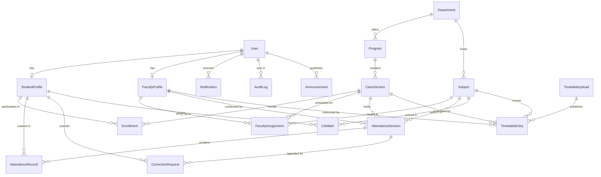

# UNILOG — Database & Entity Relationship Model

This document outlines the complete relational data model designed in Prisma ORM and SQLite for the **UNILOG College Attendance Management System**.

## 1. Mermaid Entity-Relationship (ER) Diagram

---

## 2. Model Roles and Specifications

### User
The foundational authentication entity supporting three distinct institutional roles: `ADMIN`, `FACULTY`, and `STUDENT`. Stores core identity information including email, bcrypt-hashed passwords, full name, phone number, and active account status.

### StudentProfile
One-to-one extension of `User` for students. Captures the institutional roll number (e.g. `CSE001`), branch of study, current academic semester (1–8), and section designation.

### FacultyProfile
One-to-one extension of `User` for teaching faculty. Stores the unique employee identifier (e.g. `FAC001`), department branch, academic qualifications (e.g. `Ph.D.`), and formal joining date.

### Department & Program
Hierarchical academic divisions. A department (e.g. Computer Science and Engineering) oversees degree programs (e.g. B.Tech CSE), which in turn contain multiple class sections.

### ClassSection
The active cohort unit (e.g. `CSE-3A`) grouping enrolled students for a particular semester and section. All timetable entries, lecture sessions, and enrollments bind to this model.

### Subject
Curricular course units (e.g. `CS301 Database Systems`, `CS302 Operating Systems`) belonging to a department.

### Enrollment
A many-to-many relationship linking a `StudentProfile` to an active `ClassSection`, ensuring accurate denominator calculations for class attendance.

### FacultyAssignment
The tri-partite mapping connecting a faculty instructor, a subject, and a class section. Ensures faculty members only take attendance and access rosters for their assigned classes.

### AttendanceSession
An instantiated lecture meeting held for a class section, subject, and faculty on a specific calendar date (normalized to midnight UTC) with defined start/end times (`HH:MM`). Tracks lifecycle states (`ACTIVE` vs `ENDED`), completion timestamp (`endedAt`), and optional lecture remarks.

### AttendanceRecord
Individual roll-call status entry for an enrolled student within an `AttendanceSession`. Status enum values include `PRESENT`, `ABSENT`, `LATE`, and `EXCUSED`. Records who marked the status and when.

### CorrectionRequest
Official student appeal against an absent or late record. Includes the stated reason, optional evidence document URL, current review state (`SUBMITTED`, `UNDER_REVIEW`, `APPROVED`, `REJECTED`), reviewer remarks, and audit references.

### CieMark
Continuous Internal Evaluation marks (e.g., `CIE-1`, `CIE-2`) stored per student and subject with obtained score, max score, and uploader attribution.

### AttendancePolicy
Single-row configuration entity dictating institutional attendance rules: minimum threshold percentage (default 75%), late arrival threshold (minutes), post-session edit window duration (minutes), and grace period days.

### Holiday
Academic calendar non-instructional dates that suppress class absence penalties in timeline views.

### Announcement & Notification
Campus-wide and targeted communication system. Announcements generate in-app notifications delivered to target roles (`ALL`, `FACULTY`, or `STUDENTS`).

### AuditLog
Immutable security log tracking all administrative and faculty modifications. Stores actor identity, action type, target entity, and full before/after JSON diffs.

### TimetableUpload & TimetableEntry
Manages weekly schedule imports, conflict detection (faculty double-booking, room clashes, section clashes), and the published timetable grid.
